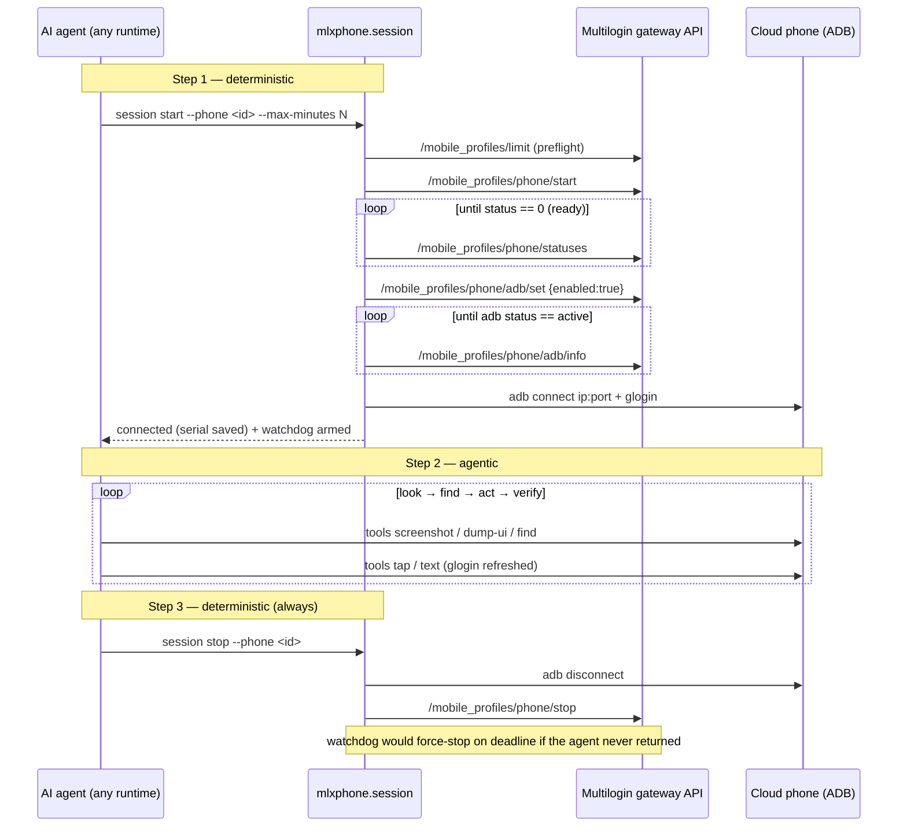

# Lifecycle sequence

The deterministic harness owns start/ADB/stop; the agent owns the actions in the
middle. The phone is **always** stopped in a `finally`, and a detached watchdog
force-stops it on a deadline as a backstop.

